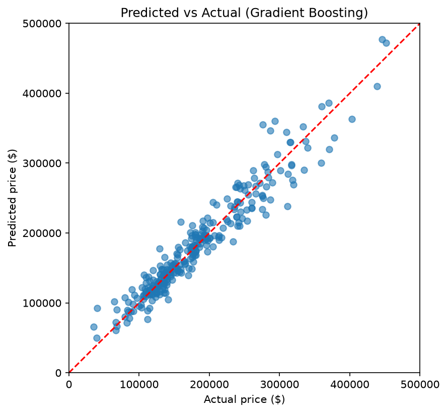

# House Price Predictor

A machine learning project that predicts house sale prices using the Ames, Iowa housing dataset (Kaggle: *House Prices - Advanced Regression Techniques*). I compared three regression models and tested them with 5-fold cross-validation.

**🔗 Live demo:** [Try the app](https://house-price-predictor-5xewysvgmxn9hag88fjkjm.streamlit.app)

## Results

| Model | Test RMSE (log) | Test R² | Avg error | CV RMSE (5-fold) |
|---|---|---|---|---|
| Linear Regression | 0.1350 | 0.8918 | $15,435 | 0.1299 ± 0.0145 |
| Random Forest | 0.1474 | 0.8712 | $16,728 | 0.1398 ± 0.0096 |
| **Gradient Boosting** | **0.1227** | **0.9107** | **$14,551** | **0.1211 ± 0.0087** |



Gradient Boosting performed best and was the most stable across folds. Its advantage over Linear Regression is modest and smaller than Linear Regression's own variation between folds, so the difference should not be over-interpreted.

## What I did

1. **Exploration:** Sale prices were right-skewed (skewness about 1.88), so I trained on `log(1 + price)`, which reduced skewness to about 0.12.
2. **Outliers:** Removed 2 houses with very large living area (over 4,000 sq ft) but low prices, which did not follow the overall trend.
3. **Cleaning:** In this dataset many blanks mean "feature not present" (for example no garage, no pool). I filled those with `"None"` or `0`, filled `LotFrontage` with the neighborhood median, and filled one missing `Electrical` value with the most common value.
4. **Encoding:** One-hot encoded categorical columns, giving 258 features.
5. **Modeling:** Trained Linear Regression, Random Forest and Gradient Boosting on an 80/20 split, then confirmed with 5-fold cross-validation.

## Key findings

- **Overall quality** is the strongest predictor, followed by **above-ground living area**, **year built**, **basement size** and **garage area**.
- The model is most accurate for houses between $100k and $250k, and less precise above $300k, where there is less data.
- A simple linear model was competitive with more complex ones, because after the log transform the relationships are close to linear.

## Limitations

- Data comes from a single city (Ames, Iowa) and a limited time period, so the model will not transfer to other markets.
- Hyperparameters were not heavily tuned.
- Several features are highly correlated (for example GarageCars and GarageArea).

## Tech stack

Python, pandas, NumPy, scikit-learn, matplotlib, seaborn, Jupyter

## How to run

**The app (locally):**

```bash
git clone https://github.com/NethmalGunathilake/house-price-predictor.git
cd house-price-predictor
python -m venv venv
venv\Scripts\activate
pip install -r requirements.txt
streamlit run app.py
```

**The notebook:** `pip install -r requirements-notebook.txt`, download `train.csv` from the [Kaggle competition page](https://www.kaggle.com/competitions/house-prices-advanced-regression-techniques/data) into a `data/` folder, then open `notebooks/01_exploration.ipynb`.

## Author

Nethmal Gunathilake: [GitHub](https://github.com/NethmalGunathilake)